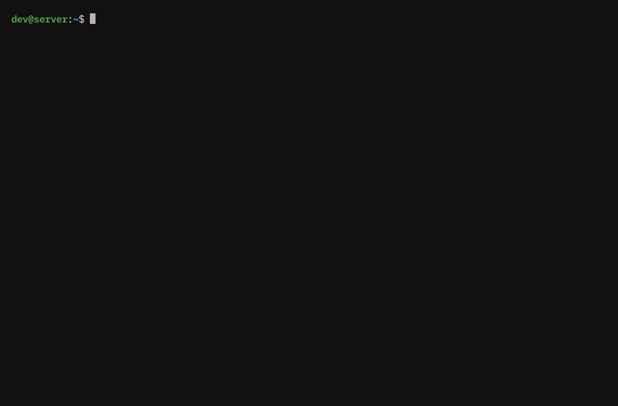

<p align="center">
  
</p>

<p align="center">
  <a href="https://github.com/edilsonvilarinho/usage-monitor/actions/workflows/ci.yml"></a>
  <a href="https://github.com/edilsonvilarinho/usage-monitor/releases/latest"></a>
  
  
  <a href="LICENSE"></a>
</p>

<p align="center">English · <a href="README.pt-BR.md">Português (Brasil)</a></p>

A desktop HUD for the quotas, usage and cost of every AI coding tool you pay for: **Claude Code**,
**Codex**, **MiniMax**, **DeepSeek**, **OpenCode Zen** and **Go**, **Kilo**, **OpenRouter**,
**Gemini CLI**, **Cursor** and **Antigravity CLI**.

A small notch docked to the edge of your screen shows one ring per account and one arc per quota.
It reads the credentials you already have, keeps history in local SQLite and never sends prompt or
response content anywhere.

The same app also works from the terminal: a status table, status lines for Claude Code and tmux,
a full-screen interactive mode and, on a Linux server without a screen, a headless service.


## Quick start

**With the window.** [Download the installer](https://github.com/edilsonvilarinho/usage-monitor/releases/latest) and open Usage Monitor: the notch docks to the
edge of the screen. Claude Code and Codex accounts are found on their own; sources that need an API
key (MiniMax, DeepSeek, OpenCode Go, OpenRouter) take it in **Settings > APIs**.

**From the terminal** — the same app, on your machine or on a server over SSH:

```sh
usage-monitor status                  # every quota: bar, state and when it resets
usage-monitor tui                     # full screen by keyboard: overview, sessions, history, team, settings
usage-monitor setup                   # first time on a server: accounts, keys, alerts and the service
usage-monitor statusline claude-code  # one line under the Claude Code prompt
```

Where the command is:

| Install | Command |
|---|---|
| Linux `.sh` | `usage-monitor` (in `~/.local/bin`) |
| Linux `.deb` / `.rpm` | `"/opt/usage-monitor/bin/Usage Monitor"`; `sudo ln -s "/opt/usage-monitor/bin/Usage Monitor" /usr/local/bin/usage-monitor` gives it the short name |
| Windows | `usage-monitor.exe` in the install folder (`%LOCALAPPDATA%\Usage Monitor`) |
| macOS | `"/Applications/Usage Monitor.app/Contents/MacOS/Usage Monitor"` |

Every command is in [Command line and terminal mode](#command-line-and-terminal-mode).

## Features

- **HUD notch** — one ring per account, one arc per quota (weekly outside, 5h inside), docked to any
  edge of any monitor. Hover a ring for its details balloon; click it to refresh that account. The
  pin next to the move hand makes it retract to a thin strip with one risk dot per account when idle.
- **Claude Code session cost** — local transcripts broken down by session, project, branch and model,
  with estimated cost and a context-health verdict. Codex CLI sessions too, token counts only.
- **History and forecast** — summary before the chart, expandable quota and window details,
  projected exhaustion, previous-period comparison and a monthly USD budget.
- **Alerts** — tray notifications when a quota crosses 75/90/100% or a session saturates, with quiet
  hours.
- **Keeps working** — each source fails on its own and keeps its last reading; rate limits back off.
- **Export** — CSV and JSON of sessions and summaries, and PDF reports. History PDF follows the
  selected source, account, range and quota and includes all available windows, even when collapsed.
- **Terminal mode** — `status`, `check` and `wait` for scripts, status lines for Claude Code and tmux,
  a full-screen interactive mode and every setting by command; on a Linux server it runs as a
  headless service.
- **Team view (optional)** — a server you host aggregates one account across machines, with a 30-day
  trend and live presence. See [`server/README.md`](server/README.md).
- **Desktop** — auto-start, light and dark themes, English and Portuguese, UI scale, in-app help
  (`F1`) and self-update on Windows and Linux.

## Install

**[Download the latest release →](https://github.com/edilsonvilarinho/usage-monitor/releases/latest)**
The installers bundle their own Java runtime.

| Platform | Download | Self-updating |
|---|---|---|
| Windows | `UsageMonitor-Setup-X.Y.Z.exe` — per-user, no admin rights | Yes |
| Linux x64 | `install-usage-monitor_X.Y.Z_linux_x64.sh` — `sh ./install-…sh`, no `sudo` | Yes |
| Linux x64 | `usage-monitor_X.Y.Z_amd64.deb` / `usage-monitor-X.Y.Z.x86_64.rpm` | No |
| macOS | `usage-monitor_X.Y.Z_macos_arm64.dmg` (Apple silicon) / `_x64.dmg` (Intel) | No |

Claude Code and Codex are found on their own. MiniMax, DeepSeek, OpenCode Go and OpenRouter need an
API key, entered in **Settings > APIs**; environment variables are never read.

<details>
<summary>Platform notes</summary>

- **Windows, coming from the old MSI:** just run `UsageMonitor-Setup`. It removes the MSI install
  first; your data in `~/.usage-monitor/` survives. If that fails the installer stops and says so —
  uninstall the MSI from *Apps & features* and run it again.
- **Linux `.sh`:** installs under `$HOME` (XDG data dir plus `~/.local/bin/usage-monitor`), always
  checks the SHA-256, keeps the previous version for rollback and refuses to run over a `.deb`/`.rpm`
  install. Not supported: musl/Alpine, ARM64, Flatpak, AppImage.
- **macOS:** the DMGs are not signed by Apple. Right-click the app in `/Applications` and choose
  **Open**, or run `xattr -dr com.apple.quarantine "/Applications/Usage Monitor.app"`.

</details>

## Command line and terminal mode



<sub>Drawn by the app's own terminal code with synthetic data (`gradlew generateTerminalMedia`).</sub>

| Option | What it does |
|---|---|
| `-h`, `--help` | Prints the options and exits |
| `-v`, `--version` | Prints the version and exits |
| `--diagnostics` | Saves a diagnostics zip (metadata only) to your home folder and exits — no window |
| `--locale <pt\|en>` | Opens the interface in that language for this run only; the saved choice does not change |
| `--user-data-dir <dir>` | Keeps this run's settings, history, keys and logs in `<dir>` instead of `~/.usage-monitor`; another folder runs side by side with the default one, with automatic updates and start with the system off |

Terminal commands read the app's last collection and never call the APIs, so the app keeps being
the one that collects. They follow the app language (`--locale` works here too):

| Command | What it does |
|---|---|
| `status [--json] [--max-age <time>]` | Prints every quota: bar, state from your alert thresholds and when it resets. `--json` is a stable contract for scripts |
| `check [--max <n>] [--max-age <time>] [--quiet]` | Exits with 0 on track, 1 warning, 2 critical, 3 no reading |
| `wait <quota> --below <n> [--timeout <time>]` | Waits until the quota drops below n% (ids in `status --json`), e.g. `usage-monitor wait anthropic:work:claude-5h --below 50 && claude -p "run the suite"` |
| `statusline claude-code` | One line under the Claude Code prompt: the account that Claude Code uses, 5h and 7d, session cost and throughput |
| `statusline tmux` | A segment for the tmux status bar |
| `tui` | The interactive mode: overview, sessions, history, team and settings in one full-screen view, by keyboard — over SSH too |

```jsonc
// ~/.claude/settings.json
"statusLine": { "type": "command", "command": "usage-monitor statusline claude-code" }
```

```sh
# ~/.tmux.conf
set -g status-right '#(usage-monitor statusline tmux)'
```

`usage-monitor tui` reads the same files and databases without writing to them (only the Team tab
asks the team server, like the app's team window). The tabs are numbered `1` to `5`; `↑ ↓` move,
`enter` opens, `r` reads again and `?` shows every key. The Settings tab changes the same things as
the commands below and shows their output; adding an account and joining a new team server stay in
the commands. It needs at least 40×12 and is drawn for 80 to 96 columns.

Everything in the Settings window can also be done from the terminal, which is what a headless
server needs. These commands write the app's own files; while the app or the service is collecting,
the change is sent to it and it is the one that writes, so it applies right away (the proxy after a
restart, as in the app). Keys and tokens are read from the input without echo, never from an argument:

| Command | What it does |
|---|---|
| `setup` | First-time setup: accounts, API keys, alerts, Telegram, language and, on Linux, the service |
| `config list\|get\|set` | Alerts, monthly budget, language, updates, Telegram bot options and proxy, by stable names such as `alerts.quota.thresholds` |
| `sources list\|enable\|disable` | The monitored sources |
| `keys set\|test\|remove <source>` | API keys; a key is tested with a real collection before it is saved |
| `accounts list\|add\|rename\|enable\|disable\|remove\|rescan` | Claude Code and Codex accounts |
| `telegram setup\|pair\|test\|status\|enable\|disable\|remove\|readonly` | The Telegram bot; `pair` waits for the chat to send `/start <code>` |
| `team join\|status\|leave` | The team integration; `join` checks the server and the account links first |
| `web enable\|disable\|status\|token` | Access from the local network; the address with the token only comes out with `token --show` |
| `alerts [--since <time>]` | Today's alerts, when and where they went |
| `update` | Checks for a new version and says how to update this install |

On a Linux server without a display, `service install` creates a systemd user service that runs the
same collection engine as the app, without a window (`service run`); `service status` shows the
health of each part and `service logs --follow` the journal. The `.deb`/`.rpm` work on a server; without
the `libGL`, `libX11` and `fontconfig` libraries the Telegram bot answers in text instead of images.

```sh
usage-monitor setup                 # answers the questions, installs the service
sudo loginctl enable-linger "$USER" # keeps it running after you leave SSH
usage-monitor service status
```

Without options it opens the app, or brings the running one to the front. On Windows, use
`usage-monitor.exe` from the install folder: `Usage Monitor.exe` is a windowed program, so its output
never reaches the terminal. The installer does not add the folder to `PATH`:

```powershell
& "$env:LOCALAPPDATA\Usage Monitor\usage-monitor.exe" --help
```

## Supported integrations

| Integration | Reads | Needs |
|---|---|---|
| Anthropic (Claude Code) | `/api/oauth/usage` | `~/.claude/.credentials.json` |
| Codex | `/backend-api/wham/usage` + local rollouts | `~/.codex/auth.json` and `~/.codex/cap_sid` |
| MiniMax · DeepSeek · OpenCode Go · OpenRouter | vendor usage/balance API | API key |
| OpenCode Zen Free · Kilo Free | local SQLite database | the tool already installed |
| Gemini CLI | `~/.gemini/tmp/*/chats/*.jsonl` | local session history (tokens only) |
| Cursor | `cursor.com/api/usage-summary` (undocumented) | a signed-in Cursor editor |
| Antigravity CLI | `agy --print /usage` | Antigravity CLI 1.2.9+, signed in |

Endpoints, credential paths and per-integration limits: [`docs/integrations.md`](docs/integrations.md).

## Privacy

- Credential files are **read only** — no login, logout or deletion.
- **No prompt or response content ever leaves the app.** The team integration sends usage metadata
  only: ids, timestamps, model, token counts, project directory, branch and machine name.
- Traffic goes only to the vendor APIs above and, if you set it up, to **your own** team server.

<details>
<summary>More screens</summary>

Rendered offscreen from the app's own components with synthetic data (`gradlew.bat generateScreenshots`).


</details>

## Reference guides

- [Integrations](docs/integrations.md) — every source: endpoints, credentials, known limits
- [Architecture](docs/architecture.md) — layers, source sets, dependency injection, storage
- [Build and release](docs/build-and-release.md) — building, packaging, CI and auto-update
- [Team server](server/README.md) — API contract and deployment
- [Contributing](CONTRIBUTING.md) · [Security](SECURITY.md) · [Changelog](CHANGELOG.md)


Issues and pull requests are welcome — start with [`CONTRIBUTING.md`](CONTRIBUTING.md).
[MIT](LICENSE) © 2026 Edilson Vilarinho
