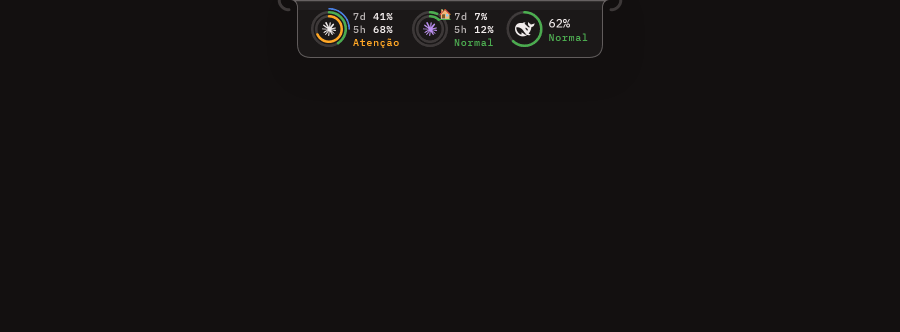
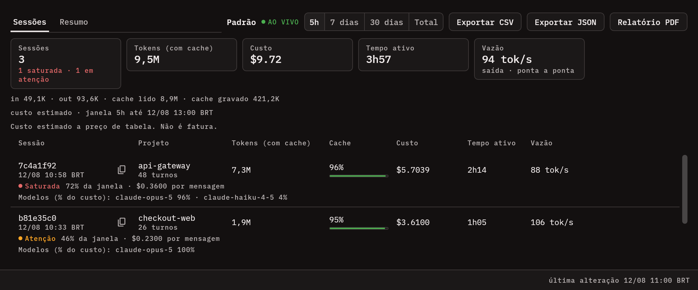
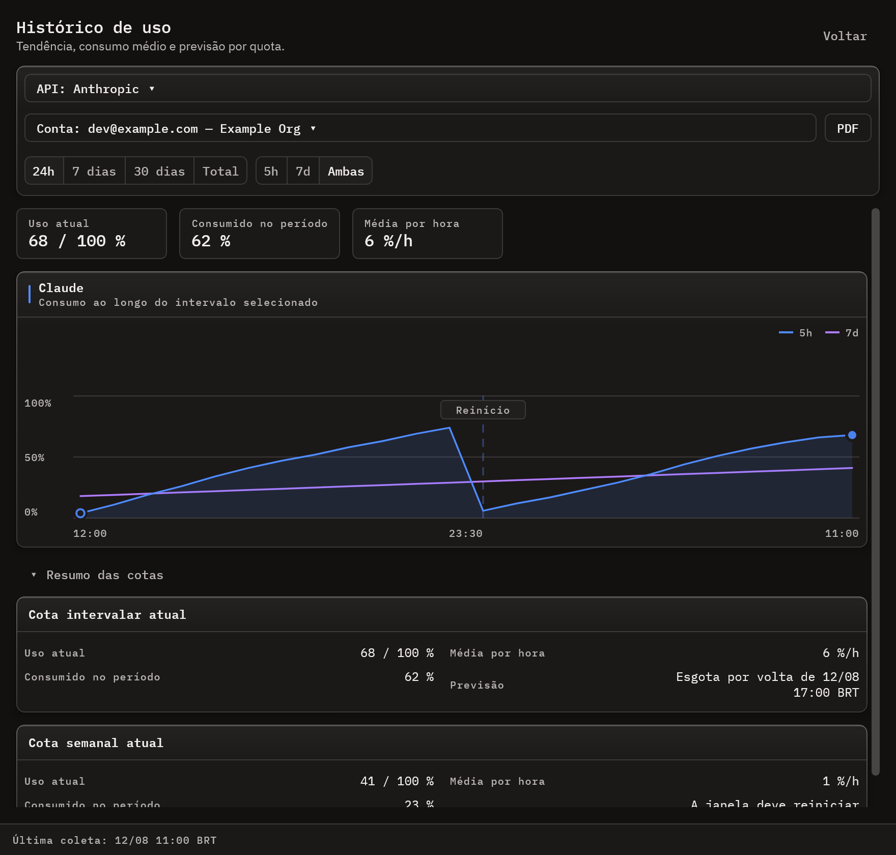
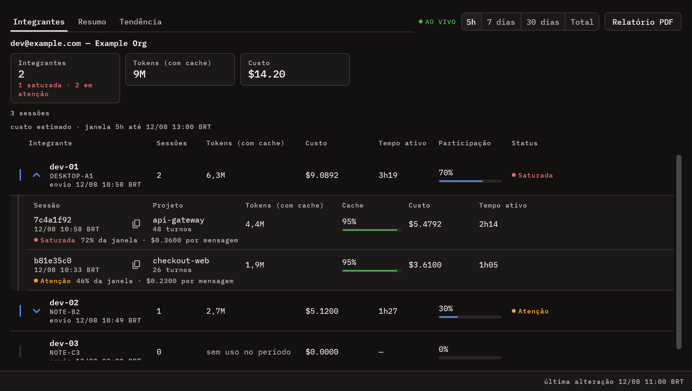
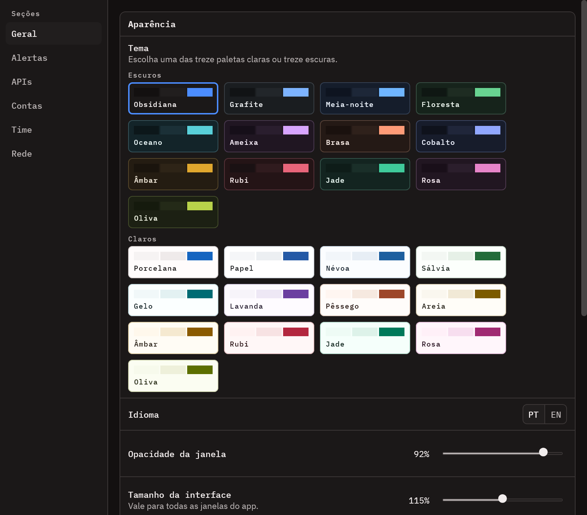

<p align="center">
  
</p>

<p align="center">
  <a href="https://github.com/edilsonvilarinho/usage-monitor/actions/workflows/ci.yml"></a>
  <a href="https://github.com/edilsonvilarinho/usage-monitor/releases/latest"></a>
  
  
  <a href="LICENSE"></a>
</p>

<p align="center"><a href="README.md">English</a> · Português (Brasil)</p>

> O [README em inglês](README.md) é o documento canônico. Esta tradução pode atrasar em relação a
> ele; em caso de divergência, vale o inglês.

Uma HUD de desktop para as cotas, o consumo e o custo de todas as ferramentas de IA que você paga:
**Claude Code**, **Codex**, **MiniMax**, **DeepSeek**, **OpenCode Zen** e **Go**, **Kilo**,
**OpenRouter**, **Gemini CLI**, **Cursor** e **Antigravity CLI**.

Um pequeno notch colado na borda da tela mostra um anel por conta e um arco por cota. Ele lê as
credenciais que você já tem, guarda o histórico em SQLite local e nunca envia conteúdo de prompt ou
de resposta para lugar nenhum.




## Recursos

- **Notch da HUD** — um anel por conta, um arco por cota (semanal por fora, 5h por dentro), colado
  em qualquer borda de qualquer monitor. Passe o ponteiro num anel para abrir o balão; clique para
  recoletar aquela conta. O alfinete ao lado da mão faz ele recolher, parado, a uma faixa fina com
  um ponto de risco por conta.
- **Custo das sessões do Claude Code** — transcripts locais abertos por sessão, projeto, branch e
  modelo, com custo estimado e um veredito de saúde do contexto. Sessões do Codex CLI também, só
  com tokens.
- **Histórico e previsão** — resumo antes do gráfico, detalhes expansíveis das cotas e janelas,
  esgotamento projetado, comparação com o período anterior e orçamento mensal em USD.
- **Alertas** — notificações na bandeja quando uma cota passa de 75/90/100% ou uma sessão satura,
  com horário de silêncio.
- **Continua funcionando** — cada fonte falha sozinha e mantém a última leitura; limite de taxa
  recua.
- **Exportação** — CSV e JSON de sessões e resumos, e relatórios em PDF. O PDF do histórico respeita
  fonte, conta, intervalo e cota selecionados e inclui todas as janelas disponíveis, mesmo recolhidas.
- **Visão de time (opcional)** — um servidor que você hospeda agrega uma conta entre máquinas, com
  tendência de 30 dias e presença ao vivo. Veja [`server/README.md`](server/README.md).
- **Desktop** — início automático, temas claro e escuro, inglês e português, escala da interface,
  ajuda no app (`F1`) e atualização automática no Windows e no Linux.

## Instalação

**[Baixe a última release →](https://github.com/edilsonvilarinho/usage-monitor/releases/latest)**
Os instaladores trazem o próprio runtime Java.

| Plataforma | Download | Atualiza sozinho |
|---|---|---|
| Windows | `UsageMonitor-Setup-X.Y.Z.exe` — por usuário, sem admin | Sim |
| Linux x64 | `install-usage-monitor_X.Y.Z_linux_x64.sh` — `sh ./install-…sh`, sem `sudo` | Sim |
| Linux x64 | `usage-monitor_X.Y.Z_amd64.deb` / `usage-monitor-X.Y.Z.x86_64.rpm` | Não |
| macOS | `usage-monitor_X.Y.Z_macos_arm64.dmg` (Apple silicon) / `_x64.dmg` (Intel) | Não |

Claude Code e Codex são encontrados sozinhos. MiniMax, DeepSeek, OpenCode Go e OpenRouter precisam
de uma chave de API, informada em **Configurações > APIs**; variáveis de ambiente nunca são lidas.

<details>
<summary>Notas por plataforma</summary>

- **Windows, vindo do MSI antigo:** basta rodar o `UsageMonitor-Setup`. Ele remove a instalação MSI
  antes; seus dados em `~/.usage-monitor/` são mantidos. Se a remoção falhar, o instalador para e
  avisa — desinstale o MSI em *Aplicativos e recursos* e rode de novo.
- **Linux `.sh`:** instala dentro do `$HOME` (diretório de dados XDG mais `~/.local/bin/usage-monitor`),
  sempre confere o SHA-256, guarda a versão anterior para rollback e se recusa a rodar sobre uma
  instalação `.deb`/`.rpm`. Sem suporte: musl/Alpine, ARM64, Flatpak, AppImage.
- **macOS:** os DMGs não são assinados pela Apple. Clique com o botão direito no app em
  `/Applications` e escolha **Abrir**, ou rode
  `xattr -dr com.apple.quarantine "/Applications/Usage Monitor.app"`.

</details>

### Linha de comando

| Opção | O que faz |
|---|---|
| `-h`, `--help` | Mostra as opções e sai |
| `-v`, `--version` | Mostra a versão e sai |
| `--diagnostics` | Grava um zip de diagnóstico (só metadados) na pasta do usuário e sai, sem abrir janela |
| `--locale <pt\|en>` | Abre a interface nesse idioma só nesta execução; a escolha gravada não muda |
| `--user-data-dir <dir>` | Guarda configurações, histórico, chaves e logs desta execução em `<dir>`, no lugar de `~/.usage-monitor`; outra pasta roda em paralelo com a padrão, com atualização automática e início com o sistema desligados |

Os comandos de terminal leem a última coleta do app e nunca consultam as APIs; quem coleta continua
sendo o app. Eles seguem o idioma do app (`--locale` vale aqui também):

| Comando | O que faz |
|---|---|
| `status [--json] [--max-age <tempo>]` | Mostra todas as cotas: barra, estado pelos seus limiares de alerta e quando reinicia. `--json` é um contrato estável para scripts |
| `check [--max <n>] [--max-age <tempo>] [--quiet]` | Sai com 0 em dia, 1 atenção, 2 crítico, 3 sem leitura |
| `wait <cota> --below <n> [--timeout <tempo>]` | Espera a cota cair abaixo de n% (os ids estão no `status --json`), por exemplo `usage-monitor wait anthropic:trabalho:claude-5h --below 50 && claude -p "rode a suíte"` |
| `statusline claude-code` | Uma linha embaixo do prompt do Claude Code: a conta que ele usa, 5h e 7d, custo e vazão da sessão |
| `statusline tmux` | Um segmento para a barra do tmux |
| `tui` | O modo interativo: visão geral, sessões, histórico, time e configurações numa tela cheia, por teclado — pelo SSH também |

```jsonc
// ~/.claude/settings.json
"statusLine": { "type": "command", "command": "usage-monitor statusline claude-code" }
```

```sh
# ~/.tmux.conf
set -g status-right '#(usage-monitor statusline tmux)'
```

`usage-monitor tui` lê os mesmos arquivos e bancos sem escrever neles (só a aba Time pergunta ao
servidor do time, como a janela de time do app). As abas vão de `1` a `5`; `↑ ↓` movem, `enter`
abre, `r` lê de novo e `?` mostra todas as teclas. A aba Configurações muda o mesmo que os comandos
abaixo e mostra a saída deles; adicionar conta e entrar num servidor de time novo ficam nos
comandos. Precisa de pelo menos 40×12 e foi desenhado para 80 a 96 colunas.

Tudo o que a janela de Configurações faz também se faz pelo terminal, que é o que um servidor sem
tela precisa. Os comandos gravam os mesmos arquivos do app; com o app ou o serviço coletando, a
mudança vai para ele, que é quem grava, e vale na hora (o proxy depois de reiniciar, como no app).
Chaves e tokens são lidos da entrada, sem eco, nunca de argumento:

| Comando | O que faz |
|---|---|
| `setup` | Configuração inicial: contas, chaves de API, avisos, Telegram, idioma e, no Linux, o serviço |
| `config list\|get\|set` | Alertas, teto mensal, idioma, atualização, opções do bot do Telegram e proxy, por nomes estáveis como `alerts.quota.thresholds` |
| `sources list\|enable\|disable` | As fontes monitoradas |
| `keys set\|test\|remove <fonte>` | Chaves de API; a chave é testada com uma coleta de verdade antes de ser gravada |
| `accounts list\|add\|rename\|enable\|disable\|remove\|rescan` | Contas do Claude Code e do Codex |
| `telegram setup\|pair\|test\|status\|enable\|disable\|remove\|readonly` | O bot do Telegram; o `pair` espera a conversa mandar `/start <código>` |
| `team join\|status\|leave` | A integração com o time; o `join` confere o servidor e o vínculo das contas antes |
| `web enable\|disable\|status\|token` | O acesso pela rede local; o endereço com o token só sai com `token --show` |
| `alerts [--since <tempo>]` | Os avisos de hoje, quando e para onde foram |
| `update` | Confere se há versão nova e diz como atualizar esta instalação |

Num servidor Linux sem tela, `service install` cria um serviço do usuário no systemd que roda o
mesmo motor de coleta do app, sem janela (`service run`); `service status` mostra a saúde de cada
parte e `service logs --follow`, o journal. O `.deb`/`.rpm` funciona num servidor; sem as bibliotecas
`libGL`, `libX11` e `fontconfig`, o bot do Telegram responde em texto no lugar das imagens.

```sh
usage-monitor setup                 # responde as perguntas e instala o serviço
sudo loginctl enable-linger "$USER" # mantém o serviço depois de sair do SSH
usage-monitor service status
```

Sem opção, abre o app ou traz para a frente o que já está aberto. No Windows, use o
`usage-monitor.exe` da pasta de instalação: o `Usage Monitor.exe` é um programa de janela, e a saída
dele nunca chega ao terminal. O instalador não põe a pasta no `PATH`:

```powershell
& "$env:LOCALAPPDATA\Usage Monitor\usage-monitor.exe" --help
```

## Integrações suportadas

| Integração | Lê | Precisa de |
|---|---|---|
| Anthropic (Claude Code) | `/api/oauth/usage` | `~/.claude/.credentials.json` |
| Codex | `/backend-api/wham/usage` + rollouts locais | `~/.codex/auth.json` e `~/.codex/cap_sid` |
| MiniMax · DeepSeek · OpenCode Go · OpenRouter | API de uso/saldo do fornecedor | chave de API |
| OpenCode Zen Free · Kilo Free | banco SQLite local | a ferramenta já instalada |
| Gemini CLI | `~/.gemini/tmp/*/chats/*.jsonl` | histórico local de sessões (só tokens) |
| Cursor | `cursor.com/api/usage-summary` (não documentada) | um editor Cursor com sessão ativa |
| Antigravity CLI | `agy --print /usage` | Antigravity CLI 1.2.9+, autenticado |

Endpoints, caminhos de credencial e limites de cada integração: [`docs/integrations.md`](docs/integrations.md).

## Privacidade

- Os arquivos de credencial são **só lidos** — sem login, logout ou exclusão.
- **Nenhum conteúdo de prompt ou de resposta sai do app.** A integração com time envia só
  metadados de uso: ids, horários, modelo, contagem de tokens, diretório do projeto, branch e nome
  da máquina.
- O tráfego vai só para as APIs dos fornecedores acima e, se você configurar, para o **seu** servidor
  de time.

<details>
<summary>Mais telas</summary>

Renderizadas offscreen a partir dos componentes do próprio app, com dados sintéticos
(`gradlew.bat generateScreenshots`).






</details>

## Guias de referência

- [Integrações](docs/integrations.md) — cada fonte: endpoints, credenciais, limites conhecidos
- [Arquitetura](docs/architecture.md) — camadas, source sets, injeção de dependências, armazenamento
- [Build e release](docs/build-and-release.md) — build, empacotamento, CI e atualização automática
- [Servidor de time](server/README.md) — contrato da API e deploy
- [Contribuindo](CONTRIBUTING.md) · [Segurança](SECURITY.md) · [Changelog](CHANGELOG.md)


Issues e pull requests são bem-vindos — comece pelo [`CONTRIBUTING.md`](CONTRIBUTING.md).
[MIT](LICENSE) © 2026 Edilson Vilarinho
